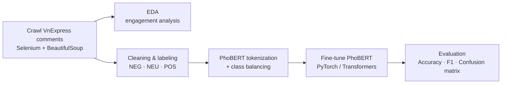

<h1 align="center">💬 Vietnamese News Comment Sentiment Classification</h1>

<p align="center">
  <b>Classifying the sentiment of Vietnamese reader comments on VnExpress with a fine-tuned PhoBERT model</b>
</p>

<p align="center">
  
  
  
  
</p>

---

## 📌 Overview

An NLP project that classifies **reader comments on Vietnamese news articles** as **Negative**, **Neutral** or **Positive**, for media monitoring and public opinion analysis. It covers the full pipeline: crawling comments from **VnExpress**, exploratory analysis of reader engagement, labeling, and fine-tuning **PhoBERT** (a RoBERTa-based model pre-trained for Vietnamese).

## 📊 Results (PhoBERT)

| Metric | Value |
|---|---|
| Accuracy | **78.25%** |
| F1-weighted | **0.78** |
| F1-macro | **0.69** |

The gap between weighted and macro F1 comes from class imbalance: **Neutral makes up only 9%** of the labeled data, so it is the hardest class. Negative and Positive are classified much more reliably.

## 🗂️ Dataset

| Stage | Size |
|---|---|
| Comments crawled from VnExpress (with article title, time, likes, replies) | **18,913** |
| Labeled comments used for training | **9,153** |

**Label distribution (training set)**

| Label | Comments | Share |
|---|---|---|
| NEG (Negative) | 4,575 | 50.0% |
| POS (Positive) | 3,761 | 41.1% |
| NEU (Neutral) | 817 | 8.9% |

## 🔄 Pipeline



### 1. Crawling (`scripts/crawl_vnexpress.py`)
- Headless Chrome with **Selenium** collects the top-story article links from the VnExpress homepage, then opens each article.
- **Loads all comments** by repeatedly clicking "view more" until no new comments appear, with random delays to crawl politely.
- Parses each comment with **BeautifulSoup**: content, likes, replies, article title and publish time. The results are exported to Excel.

### 2. Exploratory analysis (`notebooks/analysis.ipynb`)
- Cleaning: invalid titles and missing values
- **Engagement score** = likes + 2 × replies
- Top 10 most-discussed articles, most-liked comments and most-replied comments, with written observations for each chart

### 3. Sentiment model
- Fine-tuned **PhoBERT** with Hugging Face Transformers and PyTorch
- Class balancing to handle the small Neutral class
- Evaluated with Accuracy, F1 (macro and weighted) and the confusion matrix

## 📁 Project Structure

```
├── data/
│   ├── data-vnexpress-train.csv       # 9,153 labeled comments (text, label)
│   └── data-vnexpress-analysis.xlsx   # 18,913 crawled comments with metadata (EDA)
├── notebooks/
│   └── analysis.ipynb                 # engagement analysis
├── scripts/
│   └── crawl_vnexpress.py             # VnExpress comment crawler
└── requirements.txt
```

## 🚀 Quick Start

```bash
pip install -r requirements.txt

# Crawl fresh comments (requires Google Chrome)
python scripts/crawl_vnexpress.py

# Explore the data
jupyter notebook notebooks/analysis.ipynb
```

## 🔭 Future Work

- More labeled Neutral comments, or data augmentation, to improve the minority class
- Larger or multilingual models (PhoBERT-large, ViT5, XLM-R)
- Aspect-based sentiment (what the comment is positive or negative about)
- Web demo with Streamlit or Gradio

## 👤 Author

**Nguyen Hong Nhat Linh** – AI Engineer · [GitHub](https://github.com/LinhNhat07) · nlinh.nh7@gmail.com
