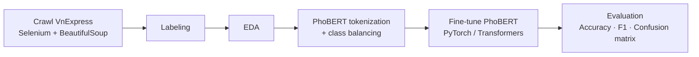

<h1 align="center">📰 Vietnamese News Sentiment Classification</h1>

<p align="center">
  <b>Classifying the sentiment of Vietnamese news articles with a fine-tuned PhoBERT model</b>
</p>

<p align="center">
  
  
  
  
</p>

---

## 📌 Overview

An NLP system that classifies Vietnamese news articles into **Negative**, **Neutral** and **Positive**, for media monitoring and public opinion analysis. It covers the full pipeline: crawling articles from **VnExpress**, labeling, fine-tuning **PhoBERT** (a RoBERTa-based model pre-trained for Vietnamese) and evaluating on an imbalanced dataset.

## 📊 Results

| Metric | Value |
|---|---|
| Accuracy | **78.25%** |
| F1-weighted | **0.78** |
| F1-macro | **0.69** |

The model performs best on the Negative and Positive classes. The gap between weighted and macro F1 reflects the natural class imbalance of news sentiment.

## 🗂️ Dataset

- **18,900** articles (title + content) crawled from VnExpress
- 3 labels: Negative / Neutral / Positive
- Class balancing applied during training

## 🔄 Pipeline



## 📁 Project Structure

```
Vietnamese-News-Sentiment-Classification/
├── data/
│   ├── data-vnexpress-train.csv       # labeled training data
│   └── data-vnexpress-analysis.xlsx   # data used for EDA
├── notebooks/
│   └── analysis.ipynb                 # exploratory data analysis
├── scripts/
│   └── crawl_vnexpress.py             # VnExpress crawler
└── requirements.txt
```

## 🚀 Quick Start

```bash
git clone https://github.com/LinhNhat07/Vietnamese-News-Sentiment-Classification.git
cd Vietnamese-News-Sentiment-Classification
pip install -r requirements.txt

# Crawl fresh articles (requires Google Chrome)
python scripts/crawl_vnexpress.py
```

## 🔭 Future Work

- More sources (Tuoi Tre, Thanh Nien, Dan Tri) for better generalization
- Larger or multilingual models (PhoBERT-large, ViT5, XLM-R)
- Aspect-based sentiment analysis
- Web demo with Streamlit or Gradio

## 👤 Author

**Nguyen Hong Nhat Linh** – AI Engineer · [GitHub](https://github.com/LinhNhat07) · nlinh.nh7@gmail.com
